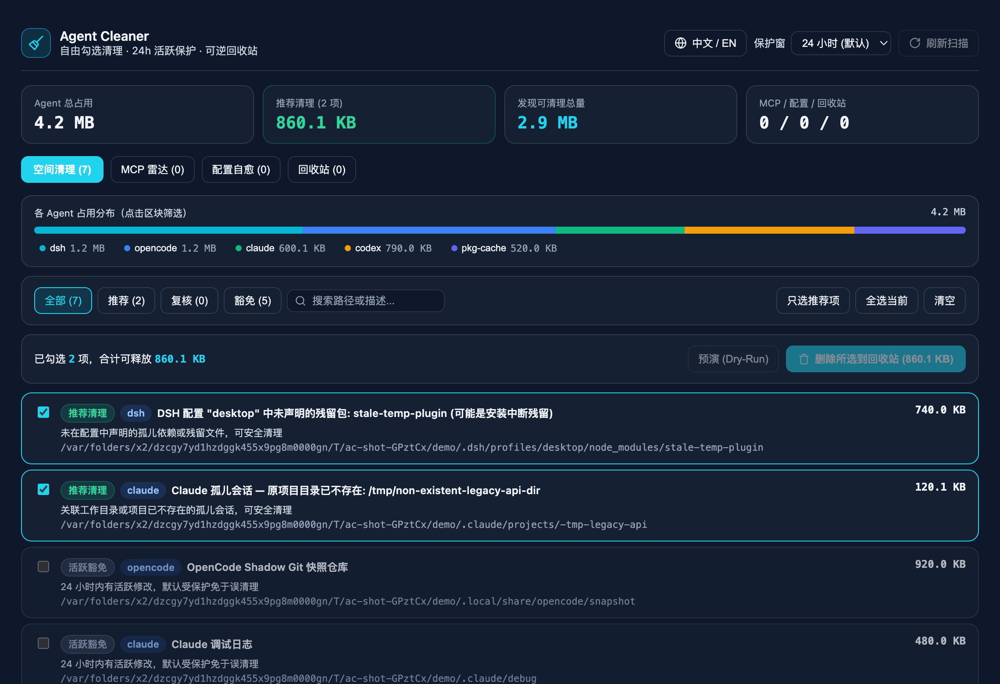

# agent-cleaner

Disk cleanup, orphan MCP process audit, and comment-preserving config repair for local AI coding tools (Claude Code, OpenCode, Codex CLI, DeepSeek Harness, Gemini/Antigravity, Cursor, Aider, Ollama).

[English](README.md) | [简体中文](README.zh-CN.md)



## Overview

AI coding agents leave behind gigabytes of shadow Git snapshots, orphaned session logs, undeclared `node_modules`, cold `npx`/`uv` caches, and zombie `PPID=1` stdio MCP processes. `agent-cleaner` provides a shared Rust engine (`cleaner-core`) with two interfaces:

- **CLI (`ac` / `agent-cleaner`)**: Fast terminal scanner, interactive cleaner, config doctor, and built-in stdio MCP server.
- **Agent Plugins (`plugins/`)**:
  - `plugins/universal`: MCP server + `SKILL.md` + slash commands for Claude Code, Cursor, and Antigravity.
  - `plugins/dsh` ([`dsh-agent-cleaner`](plugins/dsh/README.md)): Cordis plugin and sidebar panel for DeepSeek Harness (DSH).
- **Desktop app (`apps/desktop`)**: Tauri dashboard and tray with a Claude-style UI; shows free disk space of your home volume (highlighted when below 10%).

## Key Safeguards

- **Accurate Claude Code Orphan Detection**: Streams the first 30 lines of the latest `.jsonl` session file to read the real `cwd` rather than guessing from hyphenated folder names, and protects unmounted `/Volumes/*` and `/mnt/*` paths.
- **Multi-Agent Coverage**: Scans OpenCode shadow Git snapshots, Codex session logs, undeclared DSH profile packages (including `@scope/pkg`), and cold (>14d) `npm/_npx` and `uv` caches.
- **Comment-Preserving Config Doctor**: Uses CST/AST edits (`jsonc-parser`, `toml_edit`, `serde_yml`) to remove broken MCP entries without stripping comments, backing up files to `~/.agent-cleaner/backups/` beforehand.
- **Orphan MCP Process Cleanup**: Identifies `PPID=1` stdio MCP processes via `sysinfo` and terminates them (`SIGTERM` -> `1.5s` -> `SIGKILL`) without touching SSE/HTTP daemons.
- **Reversible Trash**: Exempts files modified within the last 24 hours by default. Cleaned items move to `~/.agent-cleaner/trash/<batchId>/` with cross-device (`EXDEV`) fallback and full batch restore (`ac restore <batchId>`).

## Repository Layout

```text
agent-cleaner/
├── Cargo.toml
├── crates/
│   ├── cleaner-core/       # Core scanning, trash, MCP audit, config doctor, and stdio MCP server
│   └── cleaner-cli/        # CLI binary (`ac` & `agent-cleaner`)
└── plugins/
    ├── universal/          # Claude Code / Antigravity / Cursor plugin (MCP + Skill + commands)
    └── dsh/                # DeepSeek Harness plugin (`dsh-agent-cleaner`)
```

## Quick Start

### 1. CLI (`ac` / `agent-cleaner`)

#### Option A: One-line installer (Recommended, no Rust required)

**macOS / Linux:**

```bash
curl -fsSL https://raw.githubusercontent.com/funny-dog/agent-cleaner/main/install.sh | sh
```

**Windows (PowerShell):**

```powershell
irm https://raw.githubusercontent.com/funny-dog/agent-cleaner/main/install.ps1 | iex
```

#### Option B: Run or install via `npx` / `npm` (no Rust required)

```bash
# Run immediately without installing
npx dsh-agent-cleaner

# Or install globally to get `ac` and `agent-cleaner` in PATH
npm install -g dsh-agent-cleaner
```

#### Option C: Install from local repository clone

```bash
npm run install:cli
```

#### Usage

Run `ac` with no arguments to view the overview dashboard and enter the interactive wizard, or use subcommands directly:

```bash
ac                  # Interactive wizard menu (or overview summary in non-TTY pipes)
ac scan
ac clean --dry-run
ac clean --only-recommended
ac doctor --fix
ac mcp --kill
ac restore <batchId>
```

### 2. Plugins (No Global CLI Required)

#### Option A: One-command multi-platform plugin setup (no global CLI, no PATH changes)

Automatically detects **Claude Code, Cursor, Gemini / Antigravity, Codex CLI, OpenCode, and DSH**, preserves comments and backs up existing configs to `~/.agent-cleaner/backups/`, and installs the **MCP Server (`npx -y dsh-agent-cleaner mcp-server`) + dual-channel Skill + slash commands (`/clean`, `/doctor`, `/mcp-audit`, `/restore`)**:

```bash
# Interactive setup (or use --yes to auto-install onto all detected platforms)
npx -y dsh-agent-cleaner setup
npx -y dsh-agent-cleaner setup --yes

# Or via one-line shell script
curl -fsSL https://raw.githubusercontent.com/funny-dog/agent-cleaner/main/install-plugin.sh | sh

# Check status, target specific platforms, or uninstall cleanly
npx -y dsh-agent-cleaner setup --status
npx -y dsh-agent-cleaner setup --agent claude,cursor,gemini,codex,opencode,dsh
npx -y dsh-agent-cleaner setup --uninstall
```

#### Option B: Native platform plugin / Skill commands

- **Claude Code**:
  ```text
  /plugin marketplace add funny-dog/agent-cleaner
  /plugin install agent-cleaner
  ```
- **Universal Skills (Cursor / Codex / Gemini / Claude / OpenCode)**:
  ```bash
  npx skills add funny-dog/agent-cleaner
  ```
- **DeepSeek Harness (DSH)**:
  ```bash
  dsh plugin --profile web add dsh-agent-cleaner
  ```
  See [`plugins/dsh/README.md`](plugins/dsh/README.md) for details.

## Development & Tests

```bash
cargo build --release -p cleaner-cli
cargo test --workspace
npm run typecheck
npm --workspace=dsh-agent-cleaner run build
npm --workspace=dsh-agent-cleaner test
```

## License

[MIT](LICENSE)
