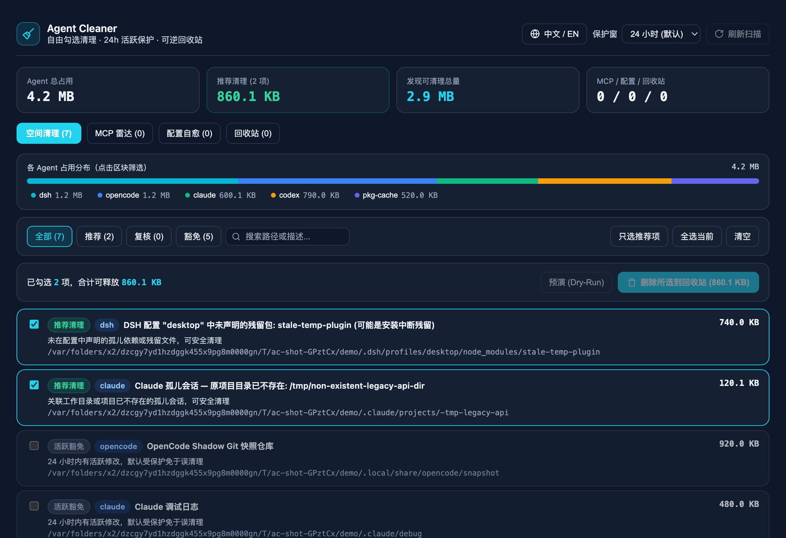

# agent-cleaner

面向本地 AI 编程工具（Claude Code、OpenCode、Codex CLI、DeepSeek Harness、Gemini/Antigravity、Cursor、Aider、Ollama）的磁盘清理、孤儿 MCP 进程查杀与配置修复工具。

[English](README.md) | [简体中文](README.zh-CN.md)



## 简介

日常使用多个 AI 编程助手时，本地往往会堆积数 GB 的 Shadow Git 快照、孤儿会话记录、安装中断残留的 `node_modules`、长期未访问的 `npx`/`uv` 缓存，以及父进程退出后残留的 `PPID=1` 僵尸 MCP 进程。

`agent-cleaner` 基于统一的 Rust 核心库（`cleaner-core`），同时提供命令行、桌面端与插件三种使用方式：

- **命令行 (`ac` / `agent-cleaner`)**：支持终端扫描、交互式勾选清理、配置修复、孤儿进程查杀，并内置标准 stdio MCP Server。
- **桌面应用 (`apps/desktop`)**：基于 Tauri 2.0，提供状态栏常驻托盘与按需加载的主管理面板。
- **客户端插件 (`plugins/`)**：
  - `plugins/universal`：适用于 Claude Code、Cursor、Antigravity 的通用插件（MCP + `SKILL.md` + 斜杠命令）。
  - `plugins/dsh`（[`dsh-agent-cleaner`](plugins/dsh/README.zh-CN.md)）：适用于 DeepSeek Harness (DSH) 的 Cordis 插件与侧边栏面板。

## 安全机制与特性

1. **Claude Code 孤儿会话精准识别**：流式读取最新 `.jsonl` 前 30 行提取真实工作目录 `cwd`，避免按目录名连字符拆分导致误判；自动识别并保护未挂载的 `/Volumes/*`、`/mnt/*` 外接磁盘路径，同时检测 `> 10MB` 的膨胀会话文件。
2. **多工具深度覆盖**：支持清理 OpenCode Shadow Git 快照、Codex `sessions/` 历史日志、DSH profile 下未声明的残留包（含 `@scope/pkg`），以及超过 14 天未访问的 `npm/_npx` 与 `uv` 缓存。
3. **保注释配置修复 (`doctor`)**：基于 `jsonc-parser`、`toml_edit` 与 YAML CST/AST 修改失效的 MCP 配置项，完整保留原有注释与缩进，写入前自动备份至 `~/.agent-cleaner/backups/`。
4. **孤儿 MCP 进程查杀**：通过 `sysinfo` 定位 `PPID=1` 的僵尸 stdio MCP 进程，按 `SIGTERM -> 1.5s -> SIGKILL` 分级退出，不触碰常驻 SSE/HTTP 服务。
5. **跨分区可逆回收站 (`trash`)**：默认豁免 24 小时内修改过的活跃文件。清理项统一移入 `~/.agent-cleaner/trash/<batchId>/` 并记录 `manifest.json`，遇到跨分区（`EXDEV`）自动回退为复制校验后删除，随时可通过 `ac restore <batchId>` 原路还原。

## 目录结构

```text
agent-cleaner/
├── Cargo.toml
├── crates/
│   ├── cleaner-core/       # Rust 核心库（扫描、回收站、MCP 审计、配置修复、MCP Server）
│   └── cleaner-cli/        # 命令行二进制 (`ac` 与 `agent-cleaner`)
├── apps/
│   └── desktop/            # Tauri 2.0 桌面端（系统托盘 + 主面板）
└── plugins/
    ├── universal/          # 通用插件（plugin.json + mcp.json + SKILL.md + commands）
    └── dsh/                # DSH 插件 (`dsh-agent-cleaner`)
```

## 快速开始

### 1. 命令行 (`ac`)

```bash
cargo build --release -p cleaner-cli

./target/release/ac scan
./target/release/ac clean --dry-run
./target/release/ac clean --only-recommended
./target/release/ac doctor --fix
./target/release/ac mcp --kill
./target/release/ac restore <batchId>
```

### 2. 桌面应用 (Tauri 2.0)

```bash
npm install
npm run dev:desktop
```

### 3. 插件接入

- **通用插件 (`plugins/universal/`)**：仓库根目录已包含 `.claude-plugin/marketplace.json`，支持通过 `agent-cleaner mcp-server` 提供 5 个标准 MCP 工具及 `/clean`、`/doctor`、`/mcp-audit` 命令。
- **DSH 插件 (`dsh-agent-cleaner`)**：包含 DSH 侧边栏可视化面板与 4 个 Cordis 工具，详见 [`plugins/dsh/README.zh-CN.md`](plugins/dsh/README.zh-CN.md)。

## 构建与测试

```bash
cargo test --workspace
npm run typecheck
npm --workspace=@agent-cleaner/desktop run build
npm --workspace=dsh-agent-cleaner run build
npm --workspace=dsh-agent-cleaner test
```

## 许可证

[MIT](LICENSE)
