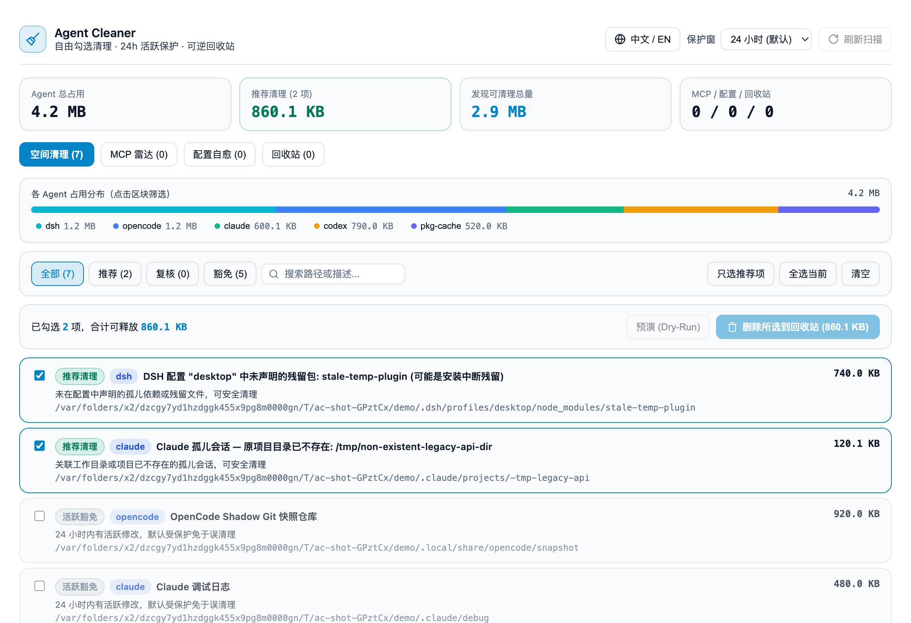

# dsh-agent-cleaner

[English](README.md) | [简体中文](README.zh-CN.md)

A DeepSeek Harness (DSH) plugin for auditing and cleaning stale AI coding agent caches, orphan sessions, zombie MCP processes, and broken configuration files — right inside DSH.

Supports **Claude Code**, **OpenCode**, **Codex CLI**, **DSH**, **Gemini / Antigravity**, **Cursor**, **Aider**, and **Ollama**.




## What You Get

- **Visual Cleanup Panel in DSH**: Open **Agent Cleaner** from the left sidebar to inspect disk usage by tool, filter by `Recommended` / `Optional` / `Active Guard (24h)`, and clean selected items.
- **Built-in DSH Agent Tools**: Registers `agent_cleaner_scan`, `agent_cleaner_clean`, `agent_cleaner_doctor`, and `agent_cleaner_mcp` so you can simply ask DSH in chat:
  - *"Scan my AI coding tool caches and tell me what can be safely cleaned."*
  - *"Check for orphan MCP processes and broken MCP configs."*
- **Reversible Trash**: Items are moved to `~/.agent-cleaner/trash/<batchId>/` instead of being permanently deleted, so you can restore any batch from the **Trash** tab at any time.
- **24h Active Guard**: Files modified within the last 24 hours are protected by default.
- **Orphan MCP Process Radar**: Detects and terminates `PPID=1` zombie stdio MCP processes without touching active SSE/HTTP services.
- **Comment-Preserving Config Doctor**: Repairs invalid MCP links across JSON, JSONC, TOML, and YAML configs while preserving comments and backups (`~/.agent-cleaner/backups/`).

## Installation

### DSH Desktop

Open **Settings → Plugins** in DSH Desktop, search for `dsh-agent-cleaner`, and install directly from the plugin panel.

### DSH Web / CLI

```bash
dsh plugin --profile web add dsh-agent-cleaner
```

Or install directly from the GitHub repository subpath:

```bash
dsh plugin --profile web add github:funny-dog/agent-cleaner#path:/plugins/dsh
```

> **Zero Setup**: On first scan, the plugin automatically downloads the matching prebuilt `agent-cleaner` engine for your OS/architecture into `~/.agent-cleaner/bin/`. No Rust toolchain is required.

## Optional Configuration

If you want to customize the 24-hour protection window, point to a local binary, or use a custom download mirror, add this to your profile's `cordis.patch.yml`:

```yaml
- id: agent-cleaner
  name: dsh-agent-cleaner
  config:
    exemptRecentHours: 24
    # binaryPath: /path/to/agent-cleaner
    # downloadUrl: https://mirror.example.com/agent-cleaner-darwin-arm64.tar.gz
```

## License

MIT
