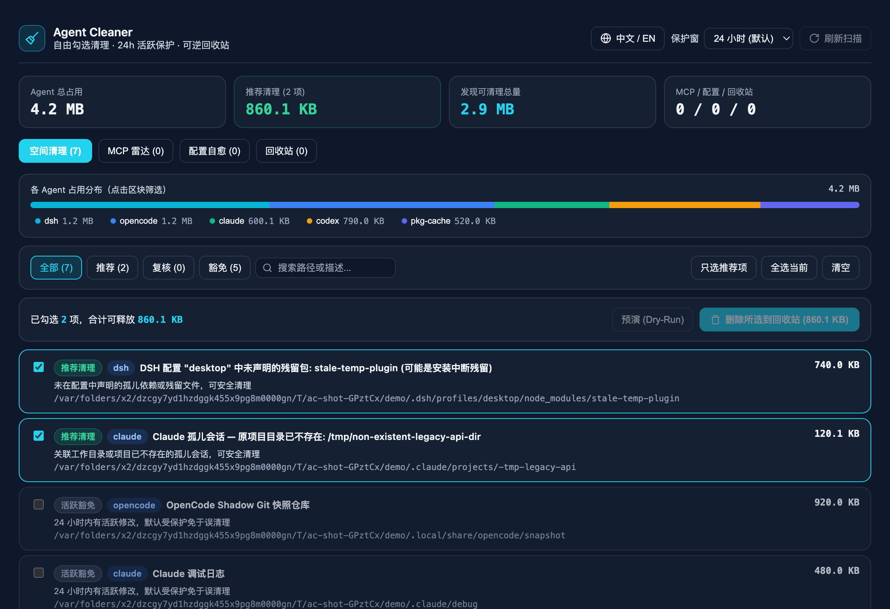

# dsh-agent-cleaner

[English](README.md) | [简体中文](README.zh-CN.md)

A DeepSeek Harness (DSH) plugin for auditing and cleaning stale AI coding agent caches, orphan sessions, zombie MCP processes, and broken configuration files — right inside DSH.

Supports **Claude Code**, **OpenCode**, **Codex CLI**, **DSH**, **Gemini / Antigravity**, **Cursor**, **Aider**, and **Ollama**.




## What You Get

- **Visual Cleanup Panel in DSH**: Open **Agent Cleaner** from the left sidebar to watch live scan progress in the radar overlay, inspect disk usage by tool, filter by `Recommended` / `Optional` / `Active Guard (24h)`, ignore paths with one click, and clean or permanently delete selected items.
- **Built-in DSH Agent Tools (8 Cordis Tools)**: Registers `agent_cleaner_overview`, `agent_cleaner_scan`, `agent_cleaner_clean`, `agent_cleaner_doctor`, `agent_cleaner_mcp`, `agent_cleaner_restore`, `agent_cleaner_config`, and `agent_cleaner_backups` so you can ask DSH in chat:
  - *"Scan my AI coding tool caches and tell me what can be safely cleaned."*
  - *"Check for orphan MCP processes, cross-agent conflicts, and broken MCP configs."*
- **Settings & Whitelist Tab**: Configure `exempt_hours`, `cold_threshold_days`, `trash_max_age_days`, `trash_max_size_mb`, `backup_max_count`, `auto_prune_trash`, `ignored_paths`, and `ignored_agents` directly from the UI.
- **Reversible Trash & Retention Pruning**: Items move to `~/.agent-cleaner/trash/<batchId>/` with configurable age/size retention policies, one-click expired batch pruning, and full restore from the **Trash** tab.
- **Orphan MCP & Conflict Radar**: Detects cross-agent MCP `conflicts`, `duplicates`, cold caches, and orphan stdio MCP processes (Unix `PPID=1` and Windows exited-parent processes) without touching active SSE/HTTP services.
- **Selective Config Doctor & Backup Rollback**: Repairs all or individual `autoFixable` MCP issues across JSON, JSONC, TOML, and YAML configs while preserving comments, with a **Config Backup History & Rollback** view in the **Config Doctor** tab.

## Installation

### DSH Desktop

Open **Settings → Plugins** in DSH Desktop, search for `dsh-agent-cleaner`, and install directly from the plugin panel.

### DSH Web / CLI

```bash
dsh plugin --profile web add dsh-agent-cleaner
```

Or install directly from the GitHub repository subpath:

```bash
dsh plugin --profile web add github:funny-dog/agent-cleaner#path:/plugins/dsh
```

> **Zero Setup (macOS / Linux / Windows)**: On first scan, the plugin automatically downloads and extracts the matching prebuilt `agent-cleaner` engine (`.tar.gz` or `.zip`) for your OS/architecture into `~/.agent-cleaner/bin/`. No Rust toolchain is required.

### Cross-Platform Plugin Injector & Standalone CLI (`npx` / `npm`)

Install Agent Cleaner plugins (MCP + Skill + `/clean`, `/doctor`, `/mcp-audit`, `/restore` commands) across Claude Code, Cursor, Gemini/Antigravity, Codex CLI, OpenCode, and DSH without installing a global CLI:

```bash
npx -y dsh-agent-cleaner setup
npx -y dsh-agent-cleaner setup --status
```

Or run the standalone interactive CLI directly:

```bash
npx dsh-agent-cleaner
```

## Optional Configuration

If you want to customize the 24-hour protection window, point to a local binary, or use a custom download mirror, add this to your profile's `cordis.patch.yml`:

```yaml
- id: agent-cleaner
  name: dsh-agent-cleaner
  config:
    exemptRecentHours: 24
    # binaryPath: /path/to/agent-cleaner
    # downloadUrl: https://mirror.example.com/agent-cleaner-darwin-arm64.tar.gz
```

## License

MIT
