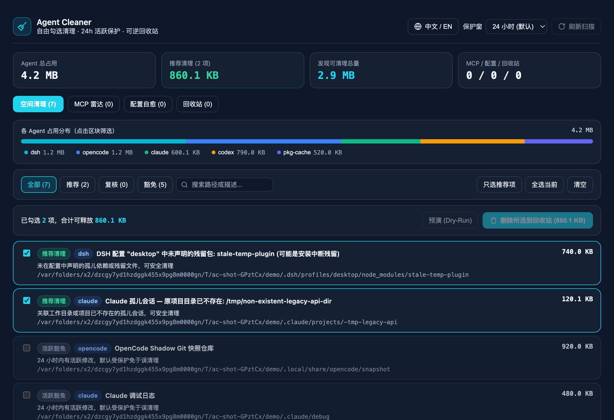
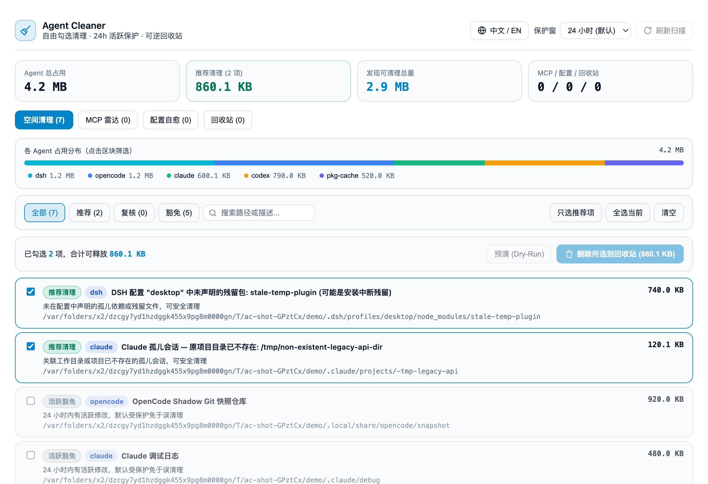

# dsh-agent-cleaner

[English](README.md) | [简体中文](README.zh-CN.md)

DeepSeek Harness (DSH) 磁盘清理与配置自愈插件。无需离开 DSH，即可在侧边栏面板或对话中一键扫描并清理本地 AI 编程工具堆积的冗余缓存、孤儿会话、僵尸 `PPID=1` MCP 进程与失效配置。

支持 **Claude Code**、**OpenCode**、**Codex CLI**、**DSH**、**Gemini / Antigravity**、**Cursor**、**Aider**、**Ollama**。





## 功能特性

- **DSH 侧边栏可视化面板**：从左侧栏打开 **Agent Cleaner**，直观查看各工具磁盘占用分布，按「推荐清理 / 建议复核 / 活跃豁免（24h）」筛选，支持按项勾选清理。
- **内置 4 个对话工具**：向 DSH 注册 `agent_cleaner_scan`、`agent_cleaner_clean`、`agent_cleaner_doctor`、`agent_cleaner_mcp`，可以直接在对话里让 DSH 帮你干活：
  - *“帮我扫描一下各 AI 编程助手占用的冗余空间和孤儿 MCP 进程”*
  - *“检查并修复 MCP 配置文件里的死链”*
- **可逆回收站时光机**：所有清理均先移入 `~/.agent-cleaner/trash/<batchId>/` 并留存清单，随时可在「回收站」标签页一键原路还原。
- **24 小时活跃保护**：默认豁免最近 24 小时内修改过的文件，避免误删当前工作会话。
- **孤儿 MCP 雷达**：精准识别父进程已退出的 `PPID=1` 僵尸 stdio MCP 进程，不误杀 SSE/HTTP 常驻服务。
- **保注释配置自愈**：无损修复 JSON、JSONC、TOML、YAML 配置文件中的失效 MCP 路径，修改前自动备份到 `~/.agent-cleaner/backups/`。

## 安装方式

### DSH Desktop（桌面端）

打开 DSH 应用内的 **设置 → 插件（市场）**，搜索 `dsh-agent-cleaner` 一键安装并启用即可。

### DSH Web / CLI 版

```bash
dsh plugin --profile web add dsh-agent-cleaner
```

或从 GitHub 子目录直接安装：

```bash
dsh plugin --profile web add github:funny-dog/agent-cleaner#path:/plugins/dsh
```

> **开箱即用**：首次触发扫描时，插件会自动拉取适配当前系统的预编译引擎到 `~/.agent-cleaner/bin/`，无需本地安装 Rust 工具链。

## 可选配置

如需修改默认保护时长、指定本地二进制路径或配置自定义下载镜像，可在 DSH profile 的 `cordis.patch.yml` 中配置：

```yaml
- id: agent-cleaner
  name: dsh-agent-cleaner
  config:
    exemptRecentHours: 24
    # binaryPath: /path/to/agent-cleaner
    # downloadUrl: https://your-mirror/agent-cleaner-darwin-arm64.tar.gz
```

## 许可证

MIT
